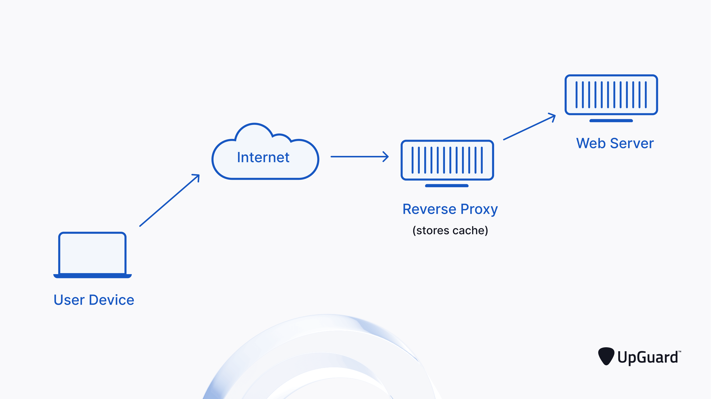

### Web browser caching
enables websites to load faster by storing frequently accessed content from web servers. The first time a user (client) visits a website, the browser must retrieve all the web assets (e.g., CSS, HTML, JavaScript, and image files) from the origin server. 
> Chipeta C. UPGUARD. Cache Explained: How It Works, Types, and When to Clear It. https://www-upguard-com.translate.goog/blog/cache?_x_tr_sl=en&_x_tr_tl=id&_x_tr_hl=id&_x_tr_pto=tc

While caching benefits users through improved load times and user experience, drawbacks like cybersecurity risks provide sufficient reason to clear cache when necessary to improve data security.

TTL: is the duration that content can be served through cache before the assets expire and need to be retrieved from the web server again.

**Cara membersihkan cache saat data sumber berubah**
1. Key eksplisit yang dipetakan dari model: `dashboard:admin`, `dashboard:dosen:{id}`, `dashboard:mahasiswa:{id}`.
2. `Cache::forget()` setelah commit, bukan di tengah transaksi. Jika key dihapus sebelum commit, request lain bisa mengisi ulang cache dengan data lama.

---

# Cache dan Config

Pola yang terlihat berulang pada tiap request: `select ... from cache`, `update cache set value = 'i:N;'`,
`insert ignore into cache`, dan `delete from cache`. Nilai `i:N;` adalah counter bilangan bulat, ciri khas
rate limiter (`throttle`). Kemungkinan besar limiter memakai store `database`. Setiap halaman memanggil 3 sampai 4 endpoint
(`/me`, `/notifications`, `/notifications/unread-count`, dan endpoint halaman itu), sehingga biaya ini berlipat.

Tindakan yang tidak perlu mengubah kode: pastikan `.env` memakai `CACHE_STORE=file` (atau `redis`) dan
`CACHE_LIMITER=file`, lalu ukur ulang. `config/cache.php` sudah menetapkan `limiter` default ke `file`;
query tabel `cache` menandakan nilai di `.env` kemungkinan menimpanya, jadi periksa baris itu.

## Keputusan cache

| Bagian | Di-cache? | TTL (batas maksimal basi) | Akibat jika basi |
|---|---|---|---|
| Dashboard `stats` admin (`total_users`, `total_courses`) | Ya | 10 menit | Hitungan meleset sedikit sampai invalidasi |
| Dashboard `stats` dosen (`total_courses`, `total_assignments`) | Ya | 5 menit | Sama |
| Dashboard `stats` mahasiswa (`total_courses`, `total_submissions`) | Ya | 5 menit | Sama |

TTL dibaca dari `config/lms.php` (`lms.cache.dashboard_ttl.*`).

### Sengaja TIDAK di-cache

| Bagian | Alasan |
|---|---|
| Blok `user` di dashboard dan `/me` | Data pribadi dan identitas. Perubahan role atau akun dihapus harus langsung berlaku |
| Hasil `Gate`/Policy dan status terdaftar di mata kuliah | Akses yang dicabut harus langsung berlaku. Cache membuat mahasiswa yang dikeluarkan tetap bisa mengakses sampai TTL habis |
| Login, check-user, reset password | Membuat token dan memeriksa kredensial. Rate limiter sudah memakai cache sendiri |
| Pengumpulan Saya (`/my/submissions`) dan nilai yang dilihat mahasiswa | `published_at` dikembalikan ke `null` saat nilai diedit. Respons cache akan terus menampilkan nilai yang sudah ditarik |
| Lihat Pengumpulan (`/assignments/{id}/submissions`) | Dosen sedang menilai dan mengharapkan perubahan langsung terlihat. Data basi memicu penilaian ganda |
| Rekap Nilai (`/courses/{id}/grade-summary`) | Berisi nilai. Daftarnya sudah dipaginasi (20 per halaman) dengan eager loading, dan query khusus endpoint ini hanya sekitar 7 sampai 8. Risiko nilai basi lebih besar daripada penghematannya |
| Daftar assignment di Lihat Kelas | `due_at`, `status`, dan `grades_count` kritis dan berubah saat menilai |
| Daftar mahasiswa terdaftar dan kandidat enrollment | Admin langsung mengharapkan perubahannya terlihat (read-your-writes) |
| Daftar `/users` | Berisi email dan NIM/NIP, dan berubah lewat CRUD |
| Notifikasi dan jumlah belum dibaca | Status baca per pengguna, tombol "tandai dibaca" harus langsung berefek |
| Unduhan berkas | Respons stream yang harus lewat Policy setiap kali |

## 3. Pembersihan otomatis saat data berubah

`DashboardCacheObserver` terdaftar di `AppServiceProvider` untuk `User`, `Course`, `Assignment`, `Submission`.
Penghapusan key dilakukan setelah commit (`DB::afterCommit`), sehingga rollback tidak menghapus cache.

| Perubahan | Key yang dibersihkan |
|---|---|
| User dibuat, dihapus (soft delete), dipulihkan | `dashboard:admin:stats` |
| Course dibuat atau dihapus | admin, dosen pengampu, dan mahasiswa terdaftar atau yang punya submission (saat dihapus) |
| Dosen pengampu course diganti | dosen lama dan dosen baru |
| Assignment dibuat atau dihapus | dosen pengampu, dan mahasiswa yang punya submission di assignment itu (saat dihapus) |
| Submission dibuat atau dihapus | mahasiswa pemilik submission |
| Mahasiswa didaftarkan atau dikeluarkan | mahasiswa itu, dipanggil manual di `CourseEnrollmentController` karena `attach()`/`detach()` tidak memicu event model |

### Batasan yang diketahui

- `cascadeOnDelete` tidak memicu event model anak. Id mahasiswa terdampak dicatat di event `deleting` milik
  `Assignment` dan `Course` sebelum cascade berjalan.
- Hapus atau ubah massal lewat query builder, `DB::table()`, dan seeder dengan `WithoutModelEvents` tidak memicu event.
  Dalam kasus itu cache baru diperbarui setelah TTL habis, atau dibersihkan manual dengan
  `php artisan cache:forget dashboard:admin:stats`.
- Hindari `php artisan cache:clear` di produksi. Perintah itu ikut menghapus counter rate limiter.

## 4. Hasil sebelum dan sesudah (diisi setelah pengukuran)

Ukur `GET /api/v1/dashboard` tiga kali: sebelum cache (data di atas), cache kosong (cold), dan cache terisi (warm).
Catat hanya query yang bukan ke tabel `cache`, atau gunakan `CACHE_STORE=file` agar tabel `cache` tidak ikut terhitung.

| Role | Query sebelum | Query cold | Query warm | Durasi sebelum | Durasi warm |
|---|---|---|---|---|---|
| Admin | 2 | _isi_ | _isi_ | _isi_ | _isi_ |
| Dosen | 2 | _isi_ | _isi_ | _isi_ | _isi_ |
| Mahasiswa | 2 | _isi_ | _isi_ | _isi_ | _isi_ |

Kolom "sebelum" (2 query `COUNT`) berasal dari kode `DashboardController` sebelum diubah. Dengan store `file` atau
`redis`, hasil warm seharusnya 0 query database untuk blok `stats`.

## 5. Config: `env()` di luar `config/`

| Sebelum | Sesudah |
|---|---|
| `DemoAccountSeeder` memanggil `env('DEMO_ACCOUNT_PASSWORD', 'password')` | `config('demo.account_password')`, nilai dari `config/demo.php` |

Alasan: setelah `php artisan config:cache`, `env()` di luar `config/` mengembalikan `null`.
Di produksi, seeder kini menolak berjalan jika `DEMO_ACCOUNT_PASSWORD` kosong, supaya tidak memakai password default.
`tests/Unit/NoEnvOutsideConfigTest.php` memindai `app/`, `bootstrap/`, `routes/`, `database/`, dan `resources/`
dan gagal jika `env()` muncul lagi.
