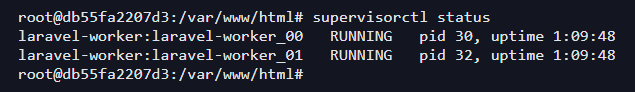

### READ — Bedah server (40 menit)

Setelah deployment pertama berhasil, tanpa AI:

1. Temukan konfigurasi Nginx untuk situs Anda. Baris mana yang menentukan document root? Ke folder apa ia mengarah?
2. Jalankan `php artisan about` di server. Bandingkan dengan lokal — apa saja yang berbeda?
3. Jalankan `supervisorctl status`. Berapa worker yang berjalan?
4. Buka `storage/logs/laravel.log`. Ada berapa entri? Baca yang terbaru.
5. Jalankan ketiga perintah `curl -I` dari daftar periksa. Catat hasilnya.
6. Buka aplikasi dari HP Anda, bukan laptop. Ada yang rusak?


### Jawaban

1. Deployment ini tidak menggunakan Nginx. `Dockerfile` menggunakan
   `php:8.4-apache`, mengaktifkan `mod_rewrite`, dan mengatur
   `APACHE_DOCUMENT_ROOT` ke `/var/www/html/public`. Jadi document root
   production adalah `/var/www/html/public`, bukan folder root repository.
   Konfigurasi ini terlihat pada bagian `ENV APACHE_DOCUMENT_ROOT` dan perintah
   `sed` yang mengubah konfigurasi virtual host Apache.
2. `php artisan about`

- Di Lokal
```
  PS C:\Users\Xufruz\OneDrive\Documents\Kuliah\Semester 5\Pemrograman Web\kelompok-lms> php artisan about

  Environment ...............................................................  
  Application Name .................................................. Laravel  
  Laravel Version ................................................... 12.71.0  
  PHP Version ........................................................ 8.4.13  
  Composer Version ................................................... 2.10.2  
  Environment ......................................................... local  
  Debug Mode ........................................................ ENABLED  
  URL ........................................................ 127.0.0.1:8000  
  Maintenance Mode ...................................................... OFF  
  Timezone .............................................................. UTC  
  Locale ................................................................. en  

  Cache .....................................................................  
  Config ......................................................... NOT CACHED  
  Events ............................................................. CACHED  
  Routes ............................................................. CACHED  
  Views .............................................................. CACHED  

  Drivers ...................................................................  
  Broadcasting ....................................................... reverb  
  Cache ................................................................ file  
  Database ........................................................... sqlite  
  Logs ....................................................... stack / single  
  Mail .................................................................. log  
  Queue ............................................................ database  
  Session .......................................................... database  

  Storage ...................................................................  
  C:\Users\Xufruz\OneDrive\Documents\Kuliah\Semester 5\Pemrograman Web\kelompok-lms\public\storage  NOT LINKED 
```

- Di Server
```
  root@b24c6cbb370c:/var/www/html# php artisan about

  Environment .............................................................................................  
  Application Name ............................................................................. LaciKampus  
  Laravel Version ................................................................................. 12.71.0  
  PHP Version ...................................................................................... 8.4.27  
  Composer Version ................................................................................. 2.11.2  
  Environment .................................................................................. production  
  Debug Mode .......................................................................................... OFF  
  URL ................................................................ lacikampus-production.up.railway.app  
  Maintenance Mode .................................................................................... OFF  
  Timezone ............................................................................................ UTC  
  Locale ............................................................................................... en  

  Cache ...................................................................................................  
  Config ....................................................................................... NOT CACHED  
  Events ....................................................................................... NOT CACHED  
  Routes ....................................................................................... NOT CACHED  
  Views ............................................................................................ CACHED  

  Drivers .................................................................................................  
  Broadcasting ....................................................................................... null  
  Cache .......................................................................................... database  
  Database .......................................................................................... mysql  
  Logs ..................................................................................... stack / single  
  Mail ................................................................................................ log  
  Queue .......................................................................................... database  
  Session ........................................................................................ database  

  Storage .................................................................................................  
  public/storage ............................................................................... NOT LINKED  
```
- Perbedaannya adalah:
  - production memakai PHP 8.4.27, sedangkan lokal memakai PHP 8.4.13;
  - production memakai environment `production`, debug `OFF`, MySQL, cache
    database, dan broadcasting `null`;
  - lokal memakai environment `local`, debug `ENABLED`, SQLite, cache file,
    dan broadcasting Reverb;
  - production memakai URL Railway, sedangkan lokal memakai `127.0.0.1:8000`;
  - production belum meng-cache config, event, dan route pada saat pengukuran,
    sedangkan lokal mencatat event, route, dan views sudah cached.

3. Berapa worker yang berjalan
   
 \
Berdasarkan konsol, hanya ada 1 worker yang sedang berjalan:\
- Nama Process: laravel-worker:laravel-worker_00\
- Status: RUNNING (PID 31)\

Konfigurasi ini sesuai dengan `numprocs=1` pada Supervisor di `Dockerfile`.

4. Log production dan jumlah entrinya tidak dapat dihitung dari browser publik.
   File `storage/logs/laravel.log` berada di dalam container Railway dan
   memerlukan akses shell atau log service Railway. Karena akses tersebut tidak
   tersedia dari repository ini, saya tidak mengklaim jumlah entri atau isi
   terbaru.

5. Pada verifikasi terakhir, tiga pemeriksaan HTTP berikut dijalankan:

   ```text
   curl -I https://lacikampus-production.up.railway.app/
   curl -I https://lacikampus-production.up.railway.app/up
   curl -I https://lacikampus-production.up.railway.app/api/v1/courses
   ```

   Ketiganya gagal sebelum menerima HTTP response dengan pesan:
   `curl: (6) Could not resolve host: lacikampus-production.up.railway.app`.
   Ini menunjukkan masalah resolusi DNS pada saat pengukuran, bukan status HTTP
   aplikasi. Saat DNS kembali normal, perintah tersebut perlu dijalankan ulang
   dan status/header dicatat.

6. Secara keseluruhan baik-baik saja, tetapi tampilan belum dipersiapkan
   sepenuhnya untuk browser HP. Pemeriksaan ini bersifat observasi manual dan
   tidak dilakukan ulang dari perangkat mobile pada sesi ini.