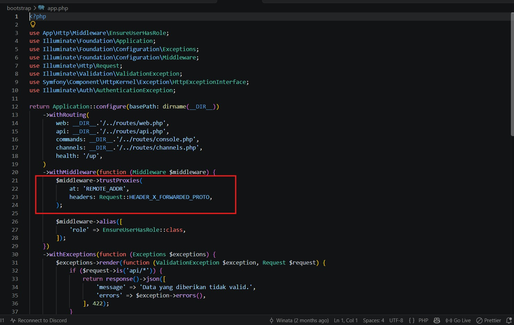

# Panduan Lengkap Deployment KampusLMS di Railway.app

Panduan ini berisi langkah-langkah praktis untuk mendeploy aplikasi Laravel 12 **KampusLMS** bersama database **MySQL bawaan Railway** secara terintegrasi dalam satu project, lengkap dengan solusi untuk berbagai kendala (troubleshooting) yang sering terjadi di lapangan.

Spesifikasi server:
- Public networking: https://lacikampus-production.up.railway.app
- maximum vCPU: 2 vCPU
- maximum Memory: 1 GB

| Role | Email | Password |
| :--- | :--- | :--- |
| **Admin** | `admin@kampuslms.test` | `test1234` |
| **Dosen** | `dosen@kampuslms.test` | `test1234` |
| **Mahasiswa** | `mahasiswa@kampuslms.test` | `test1234` |

---

## Daftar Isi
1. [Langkah 1: Menyiapkan File `Dockerfile` Siap Produksi](#langkah-1-menyiapkan-file-dockerfile-siap-produksi)
2. [Langkah 2: Membuat Project Baru di Railway.app](#langkah-2-membuat-project-baru-di-railwayapp)
3. [Langkah 3: Menambahkan Database MySQL di Railway (1-Click)](#langkah-3-menambahkan-database-mysql-di-railway-1-click)
4. [Langkah 4: Menghubungkan Repository GitHub KampusLMS](#langkah-4-menghubungkan-repository-github-kampuslms)
5. [Langkah 5: Mengonfigurasi Environment Variables](#langkah-5-mengonfigurasi-environment-variables)
6. [Langkah 6: Menghasilkan Domain Publik (HTTPS)](#langkah-6-menghasilkan-domain-publik-https)
7. [Langkah 7: Migrasi & Seeding Otomatis Database](#langkah-7-migrasi--seeding-otomatis-database)
8. [Langkah 8: Pengujian Aplikasi Live & Akun Demo](#langkah-8-pengujian-aplikasi-live--akun-demo)
9. [Troubleshooting: Kasus-Kasus Error yang Terjadi & Solusinya](#-troubleshooting-kasus-kasus-error-yang-terjadi--solusinya)

---

## Langkah 1: Menyiapkan File `Dockerfile` Siap Produksi

Railway mendukung deployment otomatis berbasis Dockerfile. Karena proyek ini menggunakan **Laravel 12** yang membutuhkan **PHP $\ge$ 8.4**, pastikan file `Dockerfile` di akar (*root*) proyek Anda menggunakan konfigurasi terbaru yang bebas konflik MPM dan port dinamis.

Simpan file **`Dockerfile`** di root folder proyek:


```dockerfile
FROM php:8.4-apache

# 1. Install ekstensi sistem & library PHP yang dibutuhkan Laravel
RUN apt-get update && apt-get install -y \
    libpng-dev \
    libonig-dev \
    libxml2-dev \
    zip \
    unzip \
    git \
    curl \
    libzip-dev \
    && docker-php-ext-install pdo_mysql mbstring exif pcntl bcmath gd zip \
    && apt-get clean && rm -rf /var/lib/apt/lists/*

# 2. Konfigurasi Apache: aktifkan mod_rewrite, pastikan hanya mpm_prefork yang aktif (hindari error More than one MPM loaded)
RUN a2enmod rewrite \
    && rm -f /etc/apache2/mods-enabled/mpm_event.* /etc/apache2/mods-enabled/mpm_worker.* \
    && a2enmod mpm_prefork \
    && sed -ri -e 's/AllowOverride None/AllowOverride All/g' /etc/apache2/apache2.conf

# 3. Atur Document Root ke /var/www/html/public
ENV APACHE_DOCUMENT_ROOT /var/www/html/public
RUN sed -ri -e 's!/var/www/html!${APACHE_DOCUMENT_ROOT}!g' /etc/apache2/sites-available/*.conf
RUN sed -ri -e 's!/var/www/!${APACHE_DOCUMENT_ROOT}!g' /etc/apache2/apache2.conf /etc/apache2/conf-available/*.conf

# 4. Install Composer resmi
COPY --from=composer:latest /usr/bin/composer /usr/bin/composer

# 5. Salin seluruh kode proyek ke container
WORKDIR /var/www/html
COPY . .

# 6. Install dependensi composer untuk mode produksi (tambahkan --ignore-platform-reqs agar selalu kompatibel)
RUN composer install --no-dev --optimize-autoloader --no-interaction --ignore-platform-reqs

# 7. Berikan hak akses ke folder storage dan cache
RUN chown -R www-data:www-data /var/www/html/storage /var/www/html/bootstrap/cache \
    && chmod -R 775 /var/www/html/storage /var/www/html/bootstrap/cache

EXPOSE 80 8080

# 8. Script startup: pastikan hanya mpm_prefork aktif, atur PORT dinamis Railway, clear cache, jalankan migrasi & seed, lalu jalankan Apache
CMD ["sh", "-c", "rm -f /etc/apache2/mods-enabled/mpm_event.* /etc/apache2/mods-enabled/mpm_worker.* && export PORT=\"${PORT:-8080}\" && sed -i \"s/Listen .*/Listen $PORT/\" /etc/apache2/ports.conf && sed -i \"s/<VirtualHost \\*:.*>/<VirtualHost \\*:$PORT>/\" /etc/apache2/sites-available/000-default.conf && php artisan config:clear && php artisan route:clear && php artisan view:clear && (php artisan migrate --force || true) && (php artisan db:seed --force || true) && exec apache2-foreground"]
```

Commit dan push ke GitHub (baik branch `production` maupun `main`):
```bash
git add Dockerfile
git commit -m "feat: production-ready Dockerfile for PHP 8.4 with auto-seed and dynamic port"
git push origin main
```


---

## Langkah 2: Membuat Project Baru di Railway.app

1. Buka situs [https://railway.app](https://railway.app).
2. Login menggunakan akun **GitHub** Anda.
3. Di dashboard utama, klik tombol **"New Project"** (atau tombol **"+ Create a New Project"**) berwarna ungu.


---

## Langkah 3: Menambahkan Database MySQL di Railway (1-Click)

1. Pada menu pilihan layanan, pilih **"Provision MySQL"** (atau klik tombol **`+`** di menu kanan kanvas $\rightarrow$ **Database** $\rightarrow$ **Add MySQL**).
2. Railway otomatis membuat satu service MySQL di dalam kanvas proyek Anda dalam waktu ~5 detik dengan status hijau (**Online**).
3. Anda tidak perlu membuat tabel manual melalui menu database, karena Laravel akan mengisinya secara otomatis.


---

## Langkah 4: Menghubungkan Repository GitHub KampusLMS

1. Di dalam kanvas proyek yang sama, klik tombol **"+ Create"** (atau tombol **`+`** di menu kanan kanvas).
2. Pilih opsi **"GitHub Repo"**.
3. Cari dan pilih repository proyek **`kampuslms`** Anda.
4. Pastikan branch yang terhubung adalah **`main`**.
5. Klik **"Deploy Now"**.
6. Lalu setelah berhasil Klik kotak dengan logo github pastikan repository benar dan branch main. serta jika auto deploys tidak otomatis aktif maka aktifkan dengan mengklik tombol "+ Toggle Auto Deploy"
7. Kalau repositori tidak ada dalam daftar, klik **"Configure GitHub App"** di bawah daftar repository dan dibagian repository access pilih only select repositories dan pilih repository kampuslms yang ada. Setelah terhubung, ulangi langkah 3-5.


---

## Langkah 5: Mengonfigurasi Environment Variables

Agar Laravel terhubung ke database MySQL Railway dan berjalan dalam mode produksi yang aman:

1. Klik service aplikasi web **KampusLMS** di kanvas.
2. Buka tab **"Variables"**.
3. Klik tombol **"Raw Editor"** (atau tambahkan satu per satu):
```env
APP_NAME="LaciKampus"
APP_ENV="production"
APP_KEY="base64:IVtH/qLWopDic53bP8ADrWkkcLJyiPa/Y1vNE5e7olU="
APP_DEBUG="false"
APP_URL="https://${{RAILWAY_PUBLIC_DOMAIN}}"
DB_CONNECTION="mysql"
DB_HOST="${{MySQL.MYSQLHOST}}"
DB_PORT="${{MySQL.MYSQLPORT}}"
DB_DATABASE="${{MySQL.MYSQLDATABASE}}"
DB_USERNAME="${{MySQL.MYSQLUSER}}"
DB_PASSWORD="${{MySQL.MYSQLPASSWORD}}"
SESSION_DRIVER="database"
QUEUE_CONNECTION="database"
FILESYSTEM_DISK="local"
```
> 💡 **Fitur Canggih Railway:** Penulisan `${{MySQL.MYSQLHOST}}` otomatis menarik alamat host internal dari service MySQL yang kita buat di Langkah 3. Koneksi antar-service ini gratis bandwidth, aman dari internet luar, dan sangat cepat!


> 📸 **Keterangan:**
> jika sudah berhasil tampilannya akan seperti ini.

---

## Langkah 6: Menghasilkan Domain Publik (HTTPS)

Secara default, service di Railway belum memiliki URL publik sampai Anda mengaktifkannya:

1. Masih di service aplikasi **KampusLMS**, buka tab **"Settings"**.
2. Gulir ke bawah hingga bagian **"Networking"** $\rightarrow$ **"Public Networking"**.
3. Klik tombol **"Generate Domain"**.
4. Railway akan membuatkan domain gratis berekstensi `.up.railway.app` lengkap dengan sertifikat SSL/HTTPS aktif (contoh: `kampuslms-production.up.railway.app`).


---

## Langkah 7: Migrasi & Seeding Otomatis Database

Di file `Dockerfile` terbaru kita, perintah migrasi dan seeding data demo sudah otomatis dieksekusi saat container pertama kali menyala:
```bash
php artisan migrate --force && 
php artisan db:seed --force # hanya untuk demo; JANGAN di aplikasi sungguhan
```
`--force` diperlukan karena di produksi Laravel meminta konfirmasi sebelum migrasi berjalan. Dalam skrip deployment yang tidak interaktif, pertanyaan itu tidak bisa dijawab sehingga perintahnya dibatalkan. Ini pengaman agar Anda tidak sengaja menjalankan migrate:fresh dan menghapus data sungguhan.

Jika Anda ingin memeriksa migrate & seed database sudah berjalan atau tidak:
1. Di kanvas sebelah kiri, klik kotak MySQL (service database Anda yang berwarna hijau).
2. Buka tab Database (lalu klik sub-tab Data).
3. Di sisi kiri akan muncul daftar tabel yang sudah dibuat:
4. Klik tabel users → Anda akan melihat akun admin@kampus.id, dosen@kampus.id, dan mahasiswa@kampus.id.
5. Klik tabel lainnya anda akan melihat data lainnya.


---

## Langkah 8: Pengujian Aplikasi Live & Akun Demo

1. Buka domain yang dihasilkan di Langkah 6 pada browser: https://lacikampus-production.up.railway.app
2. Pastikan halaman website sesuai dengan yang anda buat di local dan testing fungsi fungsi yang ada di dalamnya apakah sudah sesuai atau belum, silahkan debugging sesuai dengan fitur website masing masing


---

## 9. Troubleshooting: Kasus-Kasus Error yang Terjadi & Solusinya:
1. 

2. 

3. 
 
Belum menjalani `npm run build` dan membiarkan public/build di abaikan
4. 

Railway ngeblok asset frontend

---

## 10. Pengujian kode produksi

1. install `jq` di windows powershell, sebuah alat baris perintah untuk membaca dan mengolah data JSON. Untuk jalanin `test-api.sh` perlu ngambil informasi dari respons API--misalnya token login dan ID course.
```shell
winget install jqlang.jq
jq --version
```
where.exe jq -> salin lokasi file -> export PATH="$PATH:<--file lokasi yang disalin-->" -> jq --version

2. Karen `test-authz.sh` mempunyai perintah php, maka git bash memerlukan perintah php. Anda bisa mendapatkannya dengan export file php.
where.exe php -> salin lokasi file -> export PATH="$PATH:<--file lokasi yang disalin-->" -> php -v

hasil dari pengujian authz:
```bash
Runtime:       PHP 8.4.27

.........                                                           9 / 9 (100%)

Time: 01:04.581, Memory: 54.00 MB
```

3. Memastikan file `.env` tidak bisa diakses publik
```shell
curl.exe -I https://lacikampus-production.up.railway.app/.env
HTTP/1.1 403 Forbidden
Content-Type: text/html; charset=iso-8859-1
Date: Thu, 12 Nov 2026 04:01:58 GMT
Server: railway-hikari
x-railway-request-id: ruiKwiYASmuyaug0CYBc-A
x-hikari-trace: sin1.d1nj
x-railway-edge: sin1
Connection: keep-alive
```

4. Memastikan file `storage/logs/laravel.logs` tidak bisa diakses publik
```shell
curl.exe -I https://lacikampus-production.up.railway.app/storage/logs/laravel/log
HTTP/1.1 200 OK
Cache-Control: no-cache, private
Content-Type: text/html; charset=utf-8
Date: Thu, 12 Nov 2026 04:13:11 GMT
Server: railway-hikari
Set-Cookie: XSRF-TOKEN=eyJpdiI6IjU5NlZsTXF2cWNONlI5ek9TbU5FM0E9PSIsInZhbHVlIjoidjI1VmtMb0t4SnBYQ2tsSnlVbmhjdWFOOXdEMVlEM09Ka2tmNkRyZDJKeUxvMUliNFNIQXo5WmNYNzhtY1NQZXU3b1NtTmlTenpQTlJTdWhsNG9NaWZqUGNXUThnUStUNU1ZelpLRzgrS1p0ZHJrajV2MDE1WUh3L3dPSG1BSXIiLCJtYWMiOiIyMmYwYTQ2YzhjODI1NGRiYmY1ZGFjMDU4YzkwYzgwMTFjZGM3MGU2ZTVlOGVkYTMzZjRiYWYxNTNkNjBlNTU0IiwidGFnIjoiIn0%3D; expires=Thu, 12 Nov 2026 06:13:11 GMT; Max-Age=7200; path=/; secure; samesite=lax
Set-Cookie: lacikampus_session=eyJpdiI6IlhveEs2OHdpMHhjdWsyaW9UK1ZZNUE9PSIsInZhbHVlIjoiWFlVYlA1NXJlUzFlaTBaWTlIY0hML3NsKyszS1FySDRtdVlndGh0bXNvaFA1ZHM2aXFFcVhZSGk2eitoaVp1emNVV29qQXZPendqNVRKS1VuQ3Naa0xRc3p5Q1NLVWx5QUpkb0VjZ2RraSthMkVuaUd2NGsxdHVhc1ZXRERXbk4iLCJtYWMiOiI4Y2MwZTViMGU1MzI4MzU4M2YyNTk3ZmNiNWNiZDc3ZGEwOWUyZjM4YTZhMzZhMjA5ODI0MzdlMDU0MzdmOTg5IiwidGFnIjoiIn0%3D; expires=Thu, 12 Nov 2026 06:13:11 GMT; Max-Age=7200; path=/; secure; httponly; samesite=lax
vary: Accept-Encoding
x-powered-by: PHP/8.4.27
x-railway-request-id: GD-XUIYnSxqPKnB8LPU1MQ
x-hikari-trace: sin1.d1nj
x-railway-edge: sin1
Connection: keep-alive
```

5. Memastikan file `composer.json` tidak bisa diakses publik
```shell
curl.exe -I https://lacikampus-production.up.railway.app/composer.json
HTTP/1.1 200 OK
Cache-Control: no-cache, private
Content-Type: text/html; charset=utf-8
Date: Thu, 12 Nov 2026 04:14:43 GMT
Server: railway-hikari
Set-Cookie: XSRF-TOKEN=eyJpdiI6Inl4MW85cHEvVEh2VW5lWXVtV0sveUE9PSIsInZhbHVlIjoiSFhKL3ZaVGFLdUJENHl2Q0REN3lyR01UWHhDaHJZNVdrejQwWlVVb1JabUxxQ2lYOFc4RVphWDJkdjFEb0Jwb1IzU0duOTVWZFJ0ZldqVkYzQXJ4OGNpZWNPb3ZKSk42aHZqcFJrTzR0L3lMdkdNb1Fldm9RNWMrdDhzMHMyTHkiLCJtYWMiOiI3OGRkZDZmZmY1MjgyZWEwOWUwYThhMzdmMzNhNGU2OTE1ZGUxYjQzYTM2MTE3ZDhlZmMyZmU2N2E2ZWY1M2ZlIiwidGFnIjoiIn0%3D; expires=Thu, 12 Nov 2026 06:14:43 GMT; Max-Age=7200; path=/; secure; samesite=lax
Set-Cookie: lacikampus_session=eyJpdiI6IldMdUlIWnI1bGFtSWM2QXE5Y2Fwemc9PSIsInZhbHVlIjoiazE3eXBuMDd5bGVQVExyRmtRUUZRZ3IwbXFNamd2OGxoaVpXb0xSSFRGRVpBNE9rbmdoTll1Zm1qclRBcEFYUkk3ZHdWMW1KSmNqTnJ4c2c4UVBTYlprbEZJRDNlZTVNQi9mSCt4ajdXMk9tdE1PYXBFcStEYzM4Z2pPU2xkYjAiLCJtYWMiOiI1MjliYjVkZDNhOWM5MjNhN2RjZjVkYWNiNDJiN2U0MzI5YzJmZDA5Mzk4YmJlNWYxOTRkNzYwNjI3ODZiNjMzIiwidGFnIjoiIn0%3D; expires=Thu, 12 Nov 2026 06:14:43 GMT; Max-Age=7200; path=/; secure; httponly; samesite=lax
vary: Accept-Encoding
x-powered-by: PHP/8.4.27
x-railway-request-id: r2aMPrNYTouOk4urlt7tkg
x-hikari-trace: sin1.tr00
x-railway-edge: sin1
Connection: keep-alive
```
